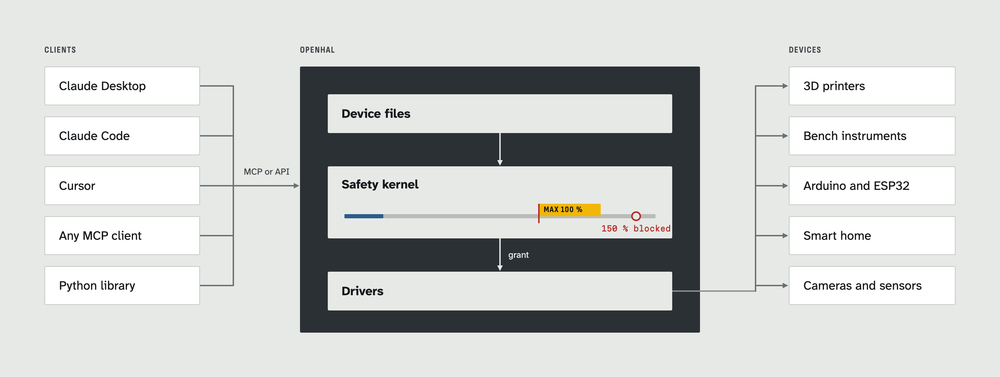

<h1 align="center">OpenHAL</h1>

<h3 align="center">One open layer between AI agents and real hardware.</h3>

<p align="center">Agents read and control your devices. A safety kernel checks every change first.</p>

<p align="center">
  <a href="#quickstart"></a>
  <a href="docs/interfaces/MCP.md"></a>
  <a href="docs/drivers/COVERAGE.md"></a>
  <a href="LICENSE"></a>
  
</p>

<p align="center"></p>

## Quickstart

```
git clone https://github.com/sohan-bhat/OpenHAL.git && cd OpenHAL
uv sync --all-extras
uv run openhal init
uv run openhald
```

`init` adds a simulated desk fan, so no hardware is needed. Connect your AI client with [docs/interfaces/MCP.md](docs/interfaces/MCP.md).

## Docs

[Safety model](docs/SAFETY.md) · [Device file spec](spec/SPEC.md) · [Drivers](docs/drivers/COVERAGE.md) · [Architecture](docs/ARCHITECTURE.md) · [Arduino library](firmware/arduino/OpenHAL/README.md)

## License

Apache-2.0
