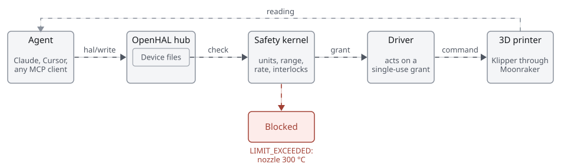

<picture>
  <source media="(prefers-color-scheme: dark)" srcset="docs/assets/wordmark-dark.svg">
  
</picture>

An open-source protocol for AI agents to control hardware.

[](LICENSE) [](https://github.com/sohan-bhat/OpenHAL/actions/workflows/ci.yml)

<!-- demo-gif:start -->
<!-- demo-gif:end -->

<picture>
  <source media="(max-width: 600px) and (prefers-color-scheme: dark)" srcset="docs/diagrams/flow-narrow-dark.svg">
  <source media="(max-width: 600px)" srcset="docs/diagrams/flow-narrow-light.svg">
  <source media="(prefers-color-scheme: dark)" srcset="docs/diagrams/flow-dark.svg">
  
</picture>

## Install

<!-- install:start -->
On macOS and Linux, run this command in a terminal.

```text
curl -LsSf https://sohan-bhat.github.io/OpenHAL/install.sh | sh
```

On Windows, run this command in PowerShell.

```text
irm https://sohan-bhat.github.io/OpenHAL/install.ps1 | iex
```
<!-- install:end -->

<!-- demo:start -->
Then run the demo. The demo uses simulated devices, so nothing touches real hardware.

```text
openhal demo
```
<!-- demo:end -->

<!-- outcome:start -->
You'll see the agent raise the bed target from 60 °C to 70 °C, have a request for a nozzle temperature of 300 °C blocked at the nozzle limit of 260 °C and pause the print when the camera shows the print has come loose. The owner then approves the cancel, and the printer's state becomes cancelled.
<!-- outcome:end -->

OpenHAL runs on Python 3.12 or newer. The installer needs nothing installed first, because the installer puts uv in place and uv installs a matching Python when the machine has none. [The install guide](docs/guide/install.md) covers uv, pipx, a clone of the repository, the background service and Raspberry Pi.

## Why OpenHAL

An AI agent that controls a 3D printer or a lab instrument usually goes through a script or an MCP server made for that one device. Each server describes the device in a different way, and whatever limits exist sit in that one server's code. OpenHAL describes every device in one file format and puts one hub between the agents and the devices, so every command goes through the same checks.

## How it works

The flow diagram follows one command. An agent sends `hal/write` to the hub, and the safety kernel checks the command against the limits in the device file. A command inside the limits gets a grant and goes through the driver to the device, and a command outside the limits is blocked with an error such as `LIMIT_EXCEEDED`.

- A `.hal.yaml` device file describes what a device can read and do, with units and limits.
- The safety kernel checks every command for range, rate, interlocks and confirmation before any driver can act.
- One driver covers a whole device family, so one SCPI driver covers bench instruments and one Moonraker driver covers Klipper printers.
- The hub's protocol is JSON-RPC 2.0 over WebSocket and stdio, and agents reach the hub through MCP, the CLI or the Python client.

## Safety model

- Every channel and action has a risk level, low, medium or high, from what it is, and the level sets where a person comes in.
- High risk channels and actions stay read-only until a person confirms their limits, and nothing an agent proposes counts as a confirmation.
- Low and medium ones take commands at once within the device's own range, and only a person lowers a level with `openhal risk set`.
- Every hardware change needs a single-use grant the kernel issues for that exact command.
- Unknown values never pass a check, so a stale or missing reading blocks the command.
- One stop puts every device in its safe state, and the hub blocks every command until a person lifts the stop.
- Every decision goes into a hash-chained audit log.

[docs/SAFETY.md](docs/SAFETY.md) has the details.

## Supported devices

OpenHAL has 34 drivers for microcontrollers, 3D printers and CNC machines, lab instruments, home automation, industrial buses, robots, telescopes, cameras and input devices. Every driver passes the conformance suite on a simulator, and no driver is verified on real hardware yet. [The hardware test plans](docs/hardware-tests/README.md) say how to run a plan on a device you own, and [the device library](library/README.md) lists the device files that come with OpenHAL. The hub gives each channel and action its own risk level, and the table's usual hazard is the hazard class of a typical device in that family. A device file's `hazard` raises every channel and action on the device to at least that level.

<details>
<summary>All 34 drivers</summary>

<!-- devices:start -->
| Driver | Devices covered | Status | Usual hazard |
|---|---|---|---|
| `ble` | environmental sensors, battery powered sensors, BLE LED and relay boards | tested on simulator | low |
| `esphome` | ESP32, ESP8266, RP2040 and BK72xx boards running ESPHome, sensors, switches, lights, fans, numbers, selects and buttons defined in ESPHome YAML | tested on simulator | low |
| `firmata` | Arduino AVR boards, Arduino-compatible clones, Teensy | tested on simulator | low |
| `hid` | macropads and button boxes, knobs and jog wheels, foot switches | tested on simulator | low |
| `homeassistant` | lights, switches and smart plugs, fans | tested on simulator | low |
| `http` | smart plugs and relays, networked sensors, lab and bench gadgets with REST APIs | tested on simulator | medium |
| `marlin` | FDM 3D printers, pen plotters and other Marlin machines | tested on simulator | medium |
| `midi` | pad and knob controllers, keyboards, synthesizers | tested on simulator | low |
| `modbus` | energy and power meters, PLCs, variable frequency drives | tested on simulator | medium |
| `moonraker` | Klipper 3D printers (Voron, RatRig, Creality K1 and Sonic Pad, Sovol SV08, Elegoo Neptune 4, Qidi) | tested on simulator | medium |
| `mqtt` | Tasmota devices, Zigbee2MQTT bridged devices, ESPHome and Shelly devices with MQTT enabled | tested on simulator | medium |
| `octoprint` | 3D printers connected to OctoPrint (Marlin, Prusa, RepRapFirmware and Klipper with the OctoPrint connector) | tested on simulator | medium |
| `openhal-firmware` | Arduino boards, ESP32 boards, maker projects that run the OpenHAL library | tested on simulator | low |
| `rpi-camera` | Raspberry Pi Camera Module 1, 2 and 3, Raspberry Pi High Quality and Global Shutter cameras, Raspberry Pi AI Camera | tested on simulator | low |
| `rpi-gpio` | relays and relay boards, LEDs, buttons, reed switches and limit switches | tested on simulator | low |
| `scpi` | bench power supplies, multimeters, oscilloscopes | tested on simulator | medium |
| `serial` | Arduino and other microcontroller sketches, bench instruments with ASCII command sets, sensor modules with text output | tested on simulator | medium |
| `uvc` | USB webcams, USB microscopes, HDMI to USB capture cards | tested on simulator | low |
| `alpaca` | telescope mounts, focusers, cameras and power boxes, observatory domes | tested on simulator | medium |
| `grbl` | desktop CNC routers, diode and CO2 laser engravers, pen plotters | tested on simulator | high |
| `indi` | telescope mounts, focusers, astronomy cameras | tested on simulator | medium |
| `lerobot` | SO-100 and SO-101 arms, Koch and OMX arms, other LeRobot arms with joint goals | tested on simulator | high |
| `onvif` | ONVIF IP cameras, ONVIF PTZ cameras, network video recorders with ONVIF | tested on simulator | low |
| `opcua` | PLCs with an OPC UA server, LADS lab instruments, process equipment and gateways | tested on simulator | medium |
| `pylabrobot` | Hamilton STAR and STARlet, Tecan Freedom EVO, Opentrons OT-2 | tested on simulator | high |
| `ros2` | ROS 2 mobile robots, ROS 2 arms, any ROS 2 graph with rosbridge | tested on simulator | high |
| `sila2` | SiLA 2 lab devices, SiLA 2 gateways, custom SiLA 2 servers | tested on simulator | medium |
| `bambu` | Bambu Lab X1 series, Bambu Lab P1 series, Bambu Lab A1 and A1 mini | tested on simulator | medium |
| `can` | motor controllers (VESC, ODrive, CubeMars), battery management systems, CAN sensor and IO nodes | tested on simulator | medium |
| `knx` | KNX switch and dimmer actuators, KNX blind actuators, KNX room thermostats | tested on simulator | low |
| `matter` | Matter lights and plugs, Matter sensors, Matter thermostats and fans | tested on simulator | low |
| `pi-i2c-spi` | I2C temperature and humidity sensors, SPI and I2C ADCs, SPI and I2C DACs | tested on simulator | low |
| `upnp` | UPnP AV media renderers and speakers, smart TVs with DLNA rendering, internet gateways (IGD) | tested on simulator | low |
| `zigbee-zwave` | Zigbee lights, plugs and sensors, Z-Wave switches, dimmers and plugs, Z-Wave multisensors | tested on simulator | low |
<!-- devices:end -->

</details>

## Connect Claude or another MCP client

`openhal init` sets up the hub and makes a token for your AI client. When init finds Claude Desktop, Claude Code or Cursor, init adds OpenHAL to that client after you say yes, and the setup for every client is printed either way. Then start OpenHAL.

```text
openhal init
openhal start
```

Any other MCP client can start `openhal mcp` over stdio with a separate agent token, as [the MCP guide](docs/interfaces/MCP.md) shows. [Connect Claude](docs/guide/tutorials/connect-claude.md) walks through the setup by hand.

## Docs and specification

- [Documentation](https://sohan-bhat.github.io/OpenHAL/docs/) with the quickstart, guides and tutorials
- [Specification](https://sohan-bhat.github.io/OpenHAL/spec/), with every message, error and conformance level, also in [spec/](spec/SPEC.md)
- [The demo step by step](docs/QUICKSTART.md), a real run of the hub against a simulated [printer and camera](examples/print-babysitter/) with every message and the audit log
- [Mapping to Anthropic's MHS](spec/MHS-MAPPING.md). OpenHAL is not affiliated with Anthropic or with the Model Hardware Standard.

## Contributing

You can add a driver, a device file, a hardware test report or a docs fix. [CONTRIBUTING.md](.github/CONTRIBUTING.md) covers the setup and the checks, and [the driver guide](docs/drivers/WRITING-A-DRIVER.md) covers drivers. Issues labeled [good first issue](https://github.com/sohan-bhat/OpenHAL/labels/good%20first%20issue) are small and self-contained. Report a security or safety problem privately, as [SECURITY.md](.github/SECURITY.md) describes.

## License

OpenHAL is licensed under Apache-2.0, and the full text is in [LICENSE](LICENSE). Device files in `library/` are released under CC0.
