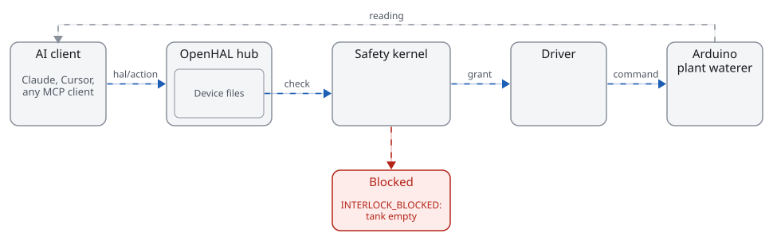

<picture>
  <source media="(prefers-color-scheme: dark)" srcset="docs/assets/wordmark-dark.svg">
  
</picture>

An open-source protocol for AI agents to control hardware.

[](LICENSE) [](https://github.com/sohan-bhat/OpenHAL/actions/workflows/ci.yml)

<picture>
  <source media="(max-width: 600px) and (prefers-color-scheme: dark)" srcset="docs/diagrams/flow-narrow-dark.svg">
  <source media="(max-width: 600px)" srcset="docs/diagrams/flow-narrow-light.svg">
  <source media="(prefers-color-scheme: dark)" srcset="docs/diagrams/flow-dark.svg">
  
</picture>

## Quickstart

You need [uv](https://docs.astral.sh/uv/) and git. Nothing touches hardware.

```
git clone https://github.com/sohan-bhat/OpenHAL
cd OpenHAL
uv run openhal demo
```

<!-- outcome:start -->
You'll see the hub refuse a 120 s watering, hold the pump while the tank is empty, then water for 20 s as soil moisture rises from 31 % to 46 %.
<!-- outcome:end -->

## Message trace

<!-- trace:start -->
```
→ hal/action  { "device": "plant-waterer", "action": "water",
                "args": { "duration": { "value": 120, "unit": "s" } } }
← error -32010 LIMIT_EXCEEDED
  water duration 120 s exceeds the limit of 30 s
  (plant-waterer.hal.yaml, confirmed by owner 2026-10-24)

# tank is empty
→ hal/action  { "device": "plant-waterer", "action": "water",
                "args": { "duration": { "value": 20, "unit": "s" } } }
← error -32012 INTERLOCK_BLOCKED
  pump can't run while tank is empty

# tank refilled
→ hal/action  { "device": "plant-waterer", "action": "water",
                "args": { "duration": { "value": 20, "unit": "s" } } }
← result      { "status": "done" }
← hal/value   soil_moisture rises from 31 % to 46 %
```
<!-- trace:end -->

The trace is a real run of the hub against the simulated [plant waterer](examples/plant-waterer/), recorded in [docs/demo/scenario.yaml](docs/demo/scenario.yaml).

## Install

```
uv tool install --compile-bytecode git+https://github.com/sohan-bhat/OpenHAL
openhal init
```

`openhal init` sets up the hub, adds the devices it finds as read-only files and prints the setup for Claude Desktop, Claude Code or Cursor. [The install guide](docs/guide/install.md) covers pipx, the background service and Raspberry Pi.

## What it does

- **One device file format.** A `.hal.yaml` file says what a device can read and do, with units and limits a person confirmed.
- **One safety kernel.** Every command is checked for range, rate, interlocks and confirmation before any driver can act.
- **Drivers for whole device families.** One SCPI driver covers bench instruments and one Moonraker driver covers Klipper printers.

## Supported devices

v0.1, in development. Every driver passes the conformance suite on a simulator.

<!-- devices:start -->
| Driver | Devices covered | Status | Hazard default |
|---|---|---|---|
| `ble` | environmental sensors, battery powered sensors, BLE LED and relay boards | tested on simulator | low |
| `esphome` | ESP32, ESP8266, RP2040 and BK72xx boards running ESPHome, sensors, switches, lights, fans, numbers, selects and buttons defined in ESPHome YAML | tested on simulator | low |
| `firmata` | Arduino AVR boards, Arduino-compatible clones, Teensy | tested on simulator | low |
| `hid` | macropads and button boxes, knobs and jog wheels, foot switches | tested on simulator | low |
| `homeassistant` | lights, switches and smart plugs, fans | tested on simulator | low |
| `http` | smart plugs and relays, networked sensors, lab and bench gadgets with REST APIs | tested on simulator | medium |
| `marlin` | FDM 3D printers, pen plotters and other Marlin machines | tested on simulator | medium |
| `midi` | pad and knob controllers, keyboards, synthesizers | tested on simulator | low |
| `modbus` | energy and power meters, PLCs, variable frequency drives | tested on simulator | medium |
| `moonraker` | Klipper 3D printers (Voron, RatRig, Creality K1 and Sonic Pad, Sovol SV08, Elegoo Neptune 4, Qidi) | tested on simulator | medium |
| `mqtt` | Tasmota devices, Zigbee2MQTT bridged devices, ESPHome and Shelly devices with MQTT enabled | tested on simulator | medium |
| `octoprint` | 3D printers connected to OctoPrint (Marlin, Prusa, RepRapFirmware and Klipper with the OctoPrint connector) | tested on simulator | medium |
| `openhal-firmware` | Arduino boards, ESP32 boards, maker projects that run the OpenHAL library | tested on simulator | low |
| `rpi-camera` | Raspberry Pi Camera Module 1, 2 and 3, Raspberry Pi High Quality and Global Shutter cameras, Raspberry Pi AI Camera | tested on simulator | low |
| `rpi-gpio` | relays and relay boards, LEDs, buttons, reed switches and limit switches | tested on simulator | low |
| `scpi` | bench power supplies, multimeters, oscilloscopes | tested on simulator | medium |
| `serial` | Arduino and other microcontroller sketches, bench instruments with ASCII command sets, sensor modules with text output | tested on simulator | medium |
| `uvc` | USB webcams, USB microscopes, HDMI to USB capture cards | tested on simulator | low |
| `alpaca` | telescope mounts, focusers, cameras and power boxes, observatory domes | tested on simulator | medium |
| `grbl` | desktop CNC routers, diode and CO2 laser engravers, pen plotters | tested on simulator | high |
| `indi` | telescope mounts, focusers, astronomy cameras | tested on simulator | medium |
| `lerobot` | SO-100 and SO-101 arms, Koch and OMX arms, other LeRobot arms with joint goals | tested on simulator | high |
| `onvif` | ONVIF IP cameras, ONVIF PTZ cameras, network video recorders with ONVIF | tested on simulator | low |
| `opcua` | PLCs with an OPC UA server, LADS lab instruments, process equipment and gateways | tested on simulator | medium |
| `pylabrobot` | Hamilton STAR and STARlet, Tecan Freedom EVO, Opentrons OT-2 | tested on simulator | high |
| `ros2` | ROS 2 mobile robots, ROS 2 arms, any ROS 2 graph with rosbridge | tested on simulator | high |
| `sila2` | SiLA 2 lab devices, SiLA 2 gateways, custom SiLA 2 servers | tested on simulator | medium |
| `bambu` | Bambu Lab X1 series, Bambu Lab P1 series, Bambu Lab A1 and A1 mini | tested on simulator | medium |
| `can` | motor controllers (VESC, ODrive, CubeMars), battery management systems, CAN sensor and IO nodes | tested on simulator | medium |
| `knx` | KNX switch and dimmer actuators, KNX blind actuators, KNX room thermostats | tested on simulator | low |
| `matter` | Matter lights and plugs, Matter sensors, Matter thermostats and fans | tested on simulator | low |
| `pi-i2c-spi` | I2C temperature and humidity sensors, SPI and I2C ADCs, SPI and I2C DACs | tested on simulator | low |
| `upnp` | UPnP AV media renderers and speakers, smart TVs with DLNA rendering, internet gateways (IGD) | tested on simulator | low |
| `zigbee-zwave` | Zigbee lights, plugs and sensors, Z-Wave switches, dimmers and plugs, Z-Wave multisensors | tested on simulator | low |
<!-- devices:end -->

## Safety model

- A device file stays read-only until a person confirms its limits, and nothing an AI proposes can confirm them.
- Drivers can only change hardware with a single-use grant the kernel issues for that exact command.
- Unknown values never pass a check, so a stale or missing reading blocks the command.
- One stop puts every device in its safe state and refuses every command until a person unlocks.
- Every decision goes into a hash-chained audit log.

Details in [docs/SAFETY.md](docs/SAFETY.md).

## Relationship to Anthropic's MHS

Anthropic's Model Hardware Standard is a limited research preview for invited labs, and OpenHAL is not affiliated with it or with Anthropic. OpenHAL is an open protocol you can use today, and we plan to stay compatible with MHS as it opens up ([mapping](spec/MHS-MAPPING.md)).

## Contributing

Build a driver with [the driver guide](docs/drivers/WRITING-A-DRIVER.md) and run the conformance suite with `uv run pytest tests/conformance`. Device files follow [spec/SPEC.md](spec/SPEC.md).

## License

Apache-2.0. See [LICENSE](LICENSE).
