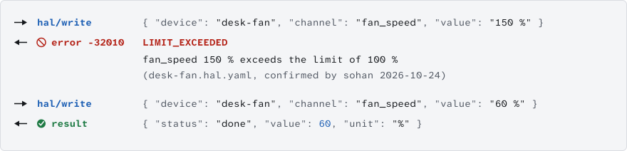

<picture>
  <source media="(prefers-color-scheme: dark)" srcset="docs/assets/wordmark-dark.svg">
  
</picture>

An open layer between AI agents and real hardware, with a safety kernel that checks every write.

[](LICENSE) [](https://github.com/sohan-bhat/OpenHAL/actions/workflows/ci.yml)

<picture>
  <source media="(prefers-color-scheme: dark)" srcset="docs/assets/trace-dark.svg">
  
</picture>

v0.1, in development. Drivers are tested on simulators, and hardware verification is in progress.

## Quickstart

```
git clone https://github.com/sohan-bhat/OpenHAL && cd OpenHAL
uv run openhal init
uv run openhald
```

The hub starts on `127.0.0.1:7420` with a simulated desk fan, ready for an MCP client ([setup](docs/interfaces/MCP.md)).

## What it does

- **One device file format.** A `.hal.yaml` file says what a device can read and change, with units and limits a person confirmed.
- **One safety kernel.** Every write is checked for range, rate, interlocks and confirmation before any driver can act.
- **Drivers for whole device families.** One SCPI driver covers bench instruments and one Moonraker driver covers Klipper printers.

<picture>
  <source media="(prefers-color-scheme: dark)" srcset="docs/assets/sequence-dark.svg">
  
</picture>

## Supported devices

<!-- devices:start -->
| Driver | Devices covered | Status | Hazard default |
|---|---|---|---|
| `ble` | environmental sensors, battery powered sensors, BLE LED and relay boards | tested on simulator | low |
| `esphome` | ESP32, ESP8266, RP2040 and BK72xx boards running ESPHome, sensors, switches, lights, fans, numbers, selects and buttons defined in ESPHome YAML | tested on simulator | low |
| `firmata` | Arduino AVR boards, Arduino-compatible clones, Teensy | tested on simulator | low |
| `hid` | macropads and button boxes, knobs and jog wheels, foot switches | tested on simulator | low |
| `homeassistant` | lights, switches and smart plugs, fans | tested on simulator | low |
| `http` | smart plugs and relays, networked sensors, lab and bench gadgets with REST APIs | tested on simulator | medium |
| `marlin` | FDM 3D printers, pen plotters and other Marlin machines | tested on simulator | medium |
| `midi` | pad and knob controllers, keyboards, synthesizers | tested on simulator | low |
| `modbus` | energy and power meters, PLCs, variable frequency drives | tested on simulator | medium |
| `moonraker` | Klipper 3D printers (Voron, RatRig, Creality K1 and Sonic Pad, Sovol SV08, Elegoo Neptune 4, Qidi) | tested on simulator | medium |
| `mqtt` | Tasmota devices, Zigbee2MQTT bridged devices, ESPHome and Shelly devices with MQTT enabled | tested on simulator | medium |
| `octoprint` | 3D printers connected to OctoPrint (Marlin, Prusa, RepRapFirmware and Klipper with the OctoPrint connector) | tested on simulator | medium |
| `openhal-firmware` | Arduino boards, ESP32 boards, maker projects that run the OpenHAL library | tested on simulator | low |
| `rpi-camera` | Raspberry Pi Camera Module 1, 2 and 3, Raspberry Pi High Quality and Global Shutter cameras, Raspberry Pi AI Camera | tested on simulator | low |
| `rpi-gpio` | relays and relay boards, LEDs, buttons, reed switches and limit switches | tested on simulator | low |
| `scpi` | bench power supplies, multimeters, oscilloscopes | tested on simulator | medium |
| `serial` | Arduino and other microcontroller sketches, bench instruments with ASCII command sets, sensor modules with text output | tested on simulator | medium |
| `uvc` | USB webcams, USB microscopes, HDMI to USB capture cards | tested on simulator | low |

Planned: `alpaca`, `grbl`, `indi`, `lerobot`, `onvif`, `opcua`, `pylabrobot`, `ros2`, `sila2`, `bambu`, `can`, `knx`, `matter`, `pi-i2c-spi`, `upnp`, `zigbee-zwave`.
<!-- devices:end -->

## Safety model

- A device file stays read-only until a person confirms its limits, and nothing an AI proposes can confirm them.
- Drivers can only change hardware with a single-use grant the kernel issues for that exact command.
- Unknown values never pass a check, so a stale or missing reading blocks the write.
- One stop puts every device in its safe state and locks writes until a person unlocks.
- Every decision goes into a hash-chained audit log.

Details in [docs/SAFETY.md](docs/SAFETY.md).

## Relationship to Anthropic's MHS

Anthropic's Model Hardware Standard is a limited research preview for invited labs, and OpenHAL is not affiliated with it or with Anthropic. OpenHAL is an open protocol you can use today, and we plan to stay compatible with MHS as it opens up ([mapping](spec/MHS-MAPPING.md)).

## Contributing

Write a driver with [docs/drivers/WRITING-A-DRIVER.md](docs/drivers/WRITING-A-DRIVER.md) and run the conformance suite with `uv run pytest tests/conformance`. Device files follow [spec/SPEC.md](spec/SPEC.md).

## License

Apache-2.0. See [LICENSE](LICENSE).
