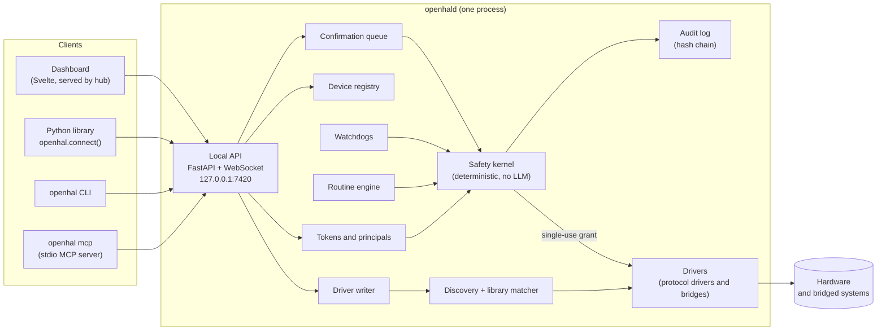
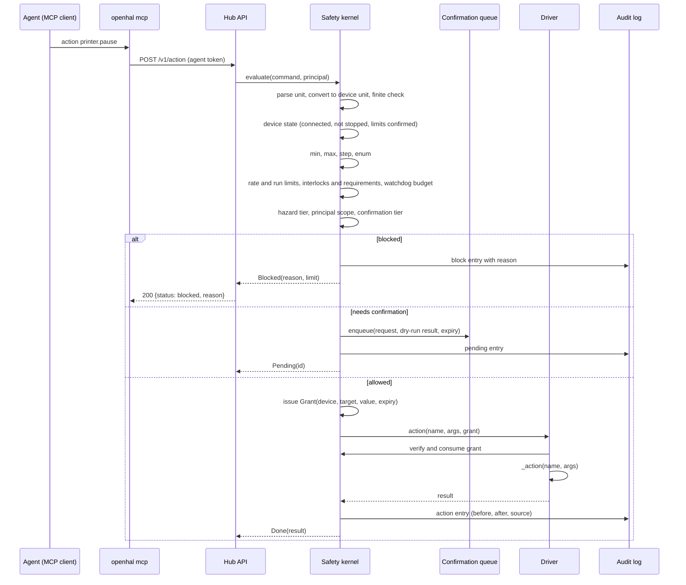
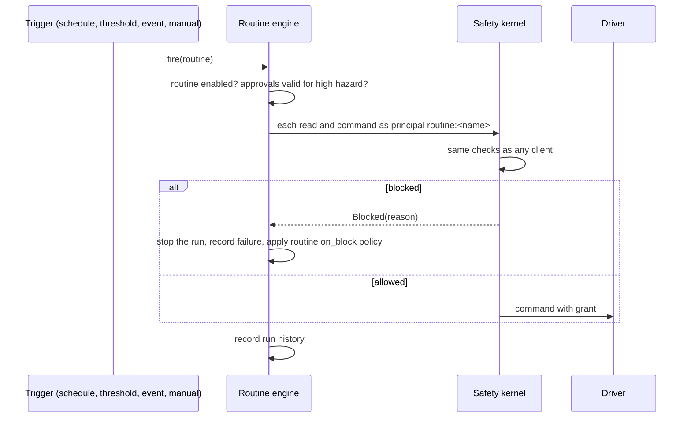
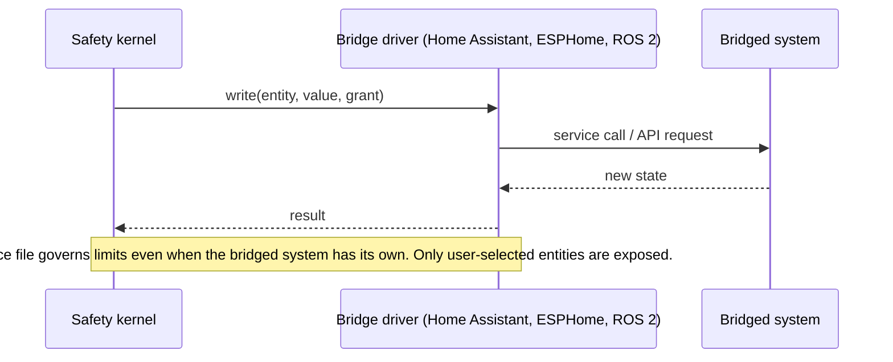
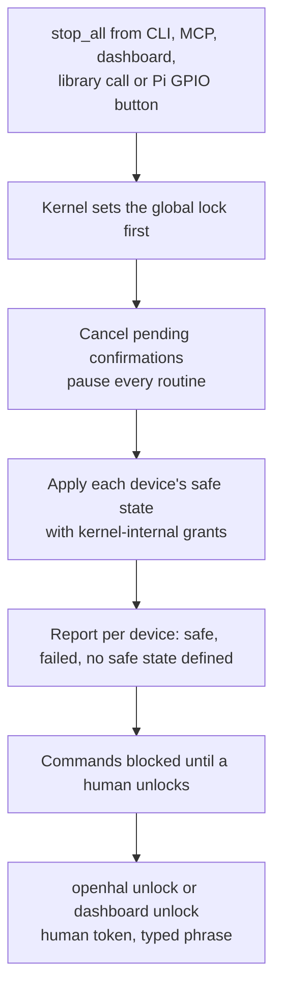

# Architecture

OpenHAL is one hub process that owns every device, plus thin clients around it. Safety lives in one deterministic kernel inside the hub. Everything else, including the MCP server an agent talks to, asks the hub.

Decisions behind this design are in docs/adr/. Safety rules are in docs/SAFETY.md. The device file format is in spec/SPEC.md.

## Components

| Component | Module | Role |
|---|---|---|
| Brand | `openhal/_brand.py` | Every public name in one place (ADR 0002) |
| Spec models | `openhal/spec/` | Pydantic models for device files, routines and commands, the unit registry, the expression language, JSON Schema export |
| Safety kernel | `openhal/kernel/` | Every check, grant issuing and verification, rate limit state, interlocks, watchdog budgets, stop lock, confirmation decisions |
| Audit log | `openhal/audit/` | Append-only SQLite table with a hash chain (ADR 0010) |
| Hub | `openhal/hub/` | Daemon, registry, config, tokens, storage, local API, discovery, library matcher, static dashboard files |
| Drivers | `openhal/drivers/` | Base class, driver registry, mock framework, one package per protocol or bridge |
| Routines | `openhal/routines/` | YAML and Python routines, triggers, scheduler |
| MCP server | `openhal/mcp/` | Tools and prompts that forward to the hub |
| CLI | `openhal/cli/` | Typer application |
| Client | `openhal/client/` | Sync and async client of the local API, used by the CLI, MCP server and library |
| Driver writer | `openhal/writer/` | Detection, sketch parsing, manual extraction, interview, staged test plans |
| Conformance | `openhal/conformance/` | The standard battery every driver must pass |
| Dashboard | `dashboard/` | Svelte 5 app, built into `openhal/hub/static/` |
| Website | `website/` | Astro site built from the repository |
| Firmware | `firmware/arduino/OpenHAL/` | Arduino library that makes a maker's device describe itself |
| Library | `library/` | Shared device files (CC0) |

## The life of a command

Every command from every source takes this path, here the printer's `pause` action from an agent. There is no other path to a driver's `_write` or `_action`.

A human approving a queued request sends `POST /v1/confirmations/{id}/approve` with a human token. The kernel evaluates the request again with current state (a confirmation never approves a stale check), then follows the allowed branch.

## Device discovery

```mermaid
flowchart TD
  S[openhal discover] --> U[USB enumeration<br/>VID:PID, class, serial number]
  S --> N[mDNS / Zeroconf browse]
  S --> V[VISA resource list]
  S --> B[BLE scan]
  S --> E[Ecosystem APIs<br/>Moonraker, OctoPrint,<br/>Home Assistant, ESPHome]
  S --> P[Platform checks<br/>Raspberry Pi GPIO and camera]
  U --> ID[identify with read-only commands only<br/>*IDN?, firmware describe, M115]
  N --> ID
  V --> ID
  B --> ID
  E --> ID
  P --> ID
  ID --> MATCH{Library matcher}
  MATCH -->|match| OFFER[Offer library file,<br/>loads read-only until limits confirmed]
  MATCH -->|protocol known| DESC[driver.describe&#40;&#41; builds a draft file]
  MATCH -->|unknown| UNK[List as unknown device,<br/>offer the driver writer]
```

Serial probing sends only identify commands that are documented as read-only for the protocol being tried, at a short timeout, and never opens a port that another process holds.

## Driver writer

```mermaid
flowchart TD
  START[Unknown device] --> LIB{1. Library match?}
  LIB -->|yes| DONE
  LIB -->|no| PROT{2. Protocol driver can talk to it?}
  PROT -->|yes| DESCRIBE[3. Self-description<br/>describe&#40;&#41;, firmware JSON,<br/>SCPI, Moonraker objects, GATT, OPC UA browse]
  PROT -->|no| CODE{4. Sketch available?}
  CODE -->|yes| SKETCH[Parse sketch<br/>commands, pins, ranges, units]
  CODE -->|no| MANUAL{5. Manual available?}
  MANUAL -->|yes| MAN[Extract commands,<br/>all marked unconfirmed]
  MANUAL -->|no| PROBE[6. Read-only probing<br/>known read commands only]
  DESCRIBE --> DRAFT[Draft device file<br/>every limit marked suggested]
  SKETCH --> DRAFT
  MAN --> DRAFT
  PROBE --> DRAFT
  DRAFT --> INT[7. Limits interview<br/>human answers every limit]
  INT --> PLAN[8. Staged test plan<br/>smallest safe value, approval per step]
  PLAN --> SCAF{9. Needs new code?}
  SCAF -->|yes| NEW[openhal driver new<br/>experimental until conformance and hardware test]
  SCAF -->|no| DONE[10. Device file with provenance<br/>plus library submission bundle]
  NEW --> DONE
```

The user's own model participates through MCP (ADR 0006). The hub does every deterministic step. Nothing a model proposes can confirm a limit.

## Routine execution

Routines run with no model. A routine's principal is `routine:<name>`, whose scope is the scope of the human who enabled the routine, capped at `control_medium`.

## Bridges

## Stop

The lock is set before any safe-state step, so a racing command can't slip in between. Safe-state steps are issued by the kernel to itself and still go through the driver's grant check.

## Contracts frozen after M1

- `spec/schema/device-file.schema.json` and the Pydantic models in `openhal/spec/models.py`.
- The driver interface in `openhal/drivers/base.py`: `discover`, `identify`, `connect`, `describe`, `read`, `write`, `action`, `safe_state`, `health`, `close`.
- The kernel API in `openhal/kernel/__init__.py`: `Kernel.evaluate`, `Kernel.execute`, `Kernel.dry_run`, `Kernel.stop_all`, `Kernel.unlock`, `Kernel.confirm`, `Kernel.reject`.
- The local API, versioned under `/v1`, described by FastAPI's OpenAPI document checked in at `docs/api/openapi.json`.
- The MCP tool list and input schemas in `openhal/mcp/tools.py`.

Changes to any of these after the freeze are made only by the orchestrator and are recorded in an ADR.
