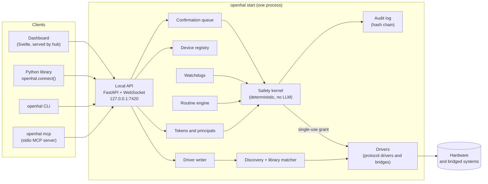
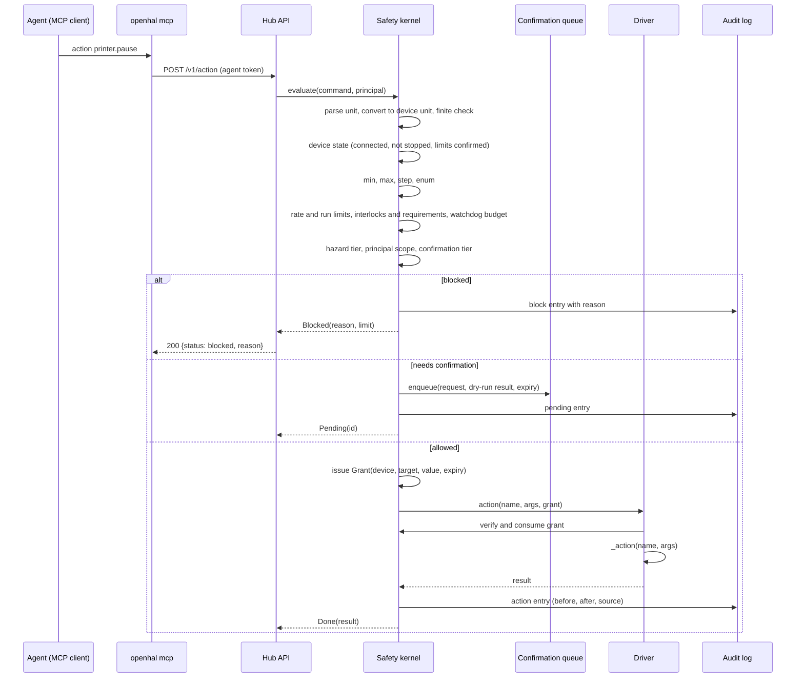
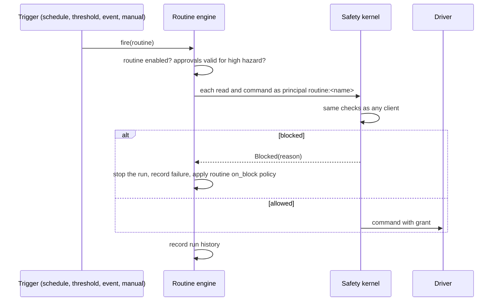
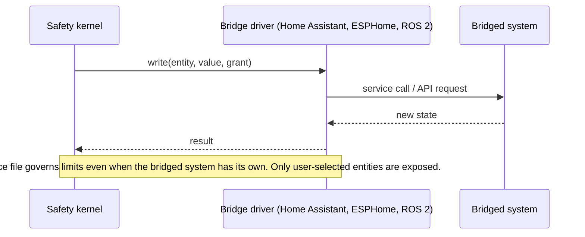
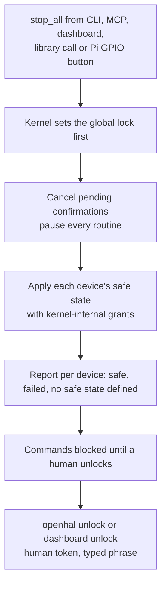

# Architecture

One hub process owns every device and checks every command in one deterministic safety kernel. Thin clients, including the MCP server an agent connects to, send requests to the hub. The decisions are in docs/adr/, the safety rules in docs/SAFETY.md and the device file format in spec/SPEC.md.

## Components

| Component | Module | Role |
|---|---|---|
| Brand | `openhal/_brand.py` | Every public name, per ADR 0002 |
| Spec models | `openhal/spec/` | Models for device files, routines and commands, units, the expression language, JSON Schema export |
| Safety kernel | `openhal/kernel/` | Checks, grants, rate limit state, interlocks, watchdog budgets, stop lock, confirmations |
| Audit log | `openhal/audit/` | Append-only SQLite table with a hash chain, per ADR 0010 |
| Hub | `openhal/hub/` | Daemon, registry, config, tokens, storage, local API, discovery, library matcher, dashboard files |
| Drivers | `openhal/drivers/` | Base class, registry, mock framework, one package per protocol or bridge |
| Routines | `openhal/routines/` | YAML and Python routines, triggers, scheduler |
| MCP server | `openhal/mcp/` | Tools and prompts that forward to the hub |
| CLI | `openhal/cli/` | Typer application |
| Client | `openhal/client/` | Sync and async API client behind the CLI, MCP server and library |
| Driver writer | `openhal/writer/` | Detection, sketch parsing, manual extraction, interview, staged test plans |
| Conformance | `openhal/conformance/` | The battery every driver must pass |
| Dashboard | `dashboard/` | Svelte 5 app, built into `openhal/hub/static/` |
| Website | `website/` | Astro site built from the repository |
| Firmware | `firmware/arduino/OpenHAL/` | Arduino library that gives a maker's device a self-description |
| Library | `library/` | Shared CC0 device files |

## The life of a command

Every command takes this path, shown for an agent's `pause` of the printer. No other path reaches a driver's `_write` or `_action`.

A person approves a queued request with `POST /v1/confirmations/{id}/approve` and a human token. The kernel checks the request again against the current state, then follows the allowed branch.

## Device discovery

```mermaid
flowchart TD
  S[openhal discover] --> U[USB enumeration<br/>VID:PID, class, serial number]
  S --> N[mDNS / Zeroconf browse]
  S --> V[VISA resource list]
  S --> B[BLE scan]
  S --> E[Ecosystem APIs<br/>Moonraker, OctoPrint,<br/>Home Assistant, ESPHome]
  S --> P[Platform checks<br/>Raspberry Pi GPIO and camera]
  U --> ID[identify with read-only commands only<br/>*IDN?, firmware describe, M115]
  N --> ID
  V --> ID
  B --> ID
  E --> ID
  P --> ID
  ID --> MATCH{Library matcher}
  MATCH -->|match| OFFER[Offer library file,<br/>high risk entries wait for confirmed limits]
  MATCH -->|protocol known| DESC[driver.describe&#40;&#41; builds a draft file]
  MATCH -->|unknown| UNK[List as unknown device,<br/>offer the driver writer]
```

Serial probing sends only identify commands documented as read-only for the protocol, with a short timeout, and never opens a port another process holds.

## Driver writer

```mermaid
flowchart TD
  START[Unknown device] --> LIB{1. Library match?}
  LIB -->|yes| DONE
  LIB -->|no| PROT{2. Can a protocol driver connect?}
  PROT -->|yes| DESCRIBE[3. Self-description<br/>describe&#40;&#41;, firmware JSON,<br/>SCPI, Moonraker objects, GATT, OPC UA browse]
  PROT -->|no| CODE{4. Sketch available?}
  CODE -->|yes| SKETCH[Parse sketch<br/>commands, pins, ranges, units]
  CODE -->|no| MANUAL{5. Manual available?}
  MANUAL -->|yes| MAN[Extract commands,<br/>all marked unconfirmed]
  MANUAL -->|no| PROBE[6. Read-only probing<br/>known read commands only]
  DESCRIBE --> DRAFT[Draft device file<br/>every limit marked suggested]
  SKETCH --> DRAFT
  MAN --> DRAFT
  PROBE --> DRAFT
  DRAFT --> INT[7. Limits interview<br/>human answers every limit]
  INT --> PLAN[8. Staged test plan<br/>smallest safe value, approval per step]
  PLAN --> SCAF{9. Needs new code?}
  SCAF -->|yes| NEW[openhal driver new<br/>experimental until conformance and hardware test]
  SCAF -->|no| DONE[10. Device file with provenance<br/>plus library submission bundle]
  NEW --> DONE
```

The user's own model takes part through MCP, per ADR 0006, and the hub runs every deterministic step. Nothing a model proposes can confirm a limit.

## Routine execution

Routines run with no model as `routine:<name>`, with the scope of the human who enabled the routine, capped at `control_medium`.

## Bridges

## Stop

The lock comes before any safe-state step, so a racing command can't slip in. The kernel issues safe-state steps to itself, and those steps still pass the driver's grant check.

## Contracts frozen after M1

- `spec/schema/device-file.schema.json` and the Pydantic models in `openhal/spec/models.py`.
- The driver interface in `openhal/drivers/base.py`, with `discover`, `identify`, `connect`, `describe`, `read`, `write`, `action`, `safe_state`, `health`, `close`.
- The kernel API in `openhal/kernel/__init__.py`, with `Kernel.evaluate`, `Kernel.execute`, `Kernel.dry_run`, `Kernel.stop_all`, `Kernel.unlock`, `Kernel.confirm`, `Kernel.reject`.
- The local API, versioned under `/v1`, described by FastAPI's OpenAPI document checked in at `docs/api/openapi.json`.
- The MCP tool list and input schemas in `openhal/mcp/tools.py`.

After the freeze, only the orchestrator changes these, and each change gets an ADR.
