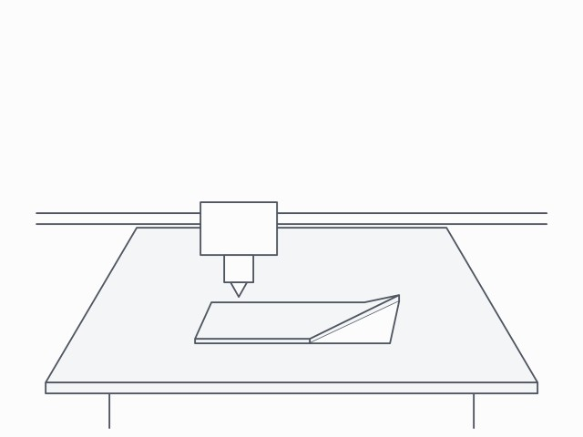
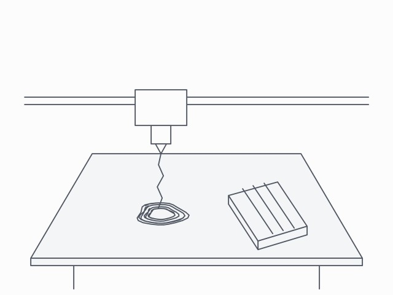

# 3D print babysitter

The canonical OpenHAL example. Someone starts a long print on a Klipper printer and asks an agent to keep an eye on the print. The agent watches the printer's camera, judges what is going wrong and acts. The hub's safety kernel checks every command against limits a person confirmed.

## What the hub reads and controls

| Name | Device | Kind | Detail |
|---|---|---|---|
| `frame` | `printer-cam` | reading | a JPEG snapshot of the bed |
| `state` | `printer` | reading | `standby`, `printing`, `paused`, `complete`, `cancelled` or `error` |
| `extruder_temp`, `bed_temp` | `printer` | reading | °C, every 1 s |
| `progress` | `printer` | reading | percent, every 5 s |
| `extruder_target` | `printer` | setting | 0 to 260 °C |
| `bed_target` | `printer` | setting | 0 to 110 °C |
| `pause`, `resume` | `printer` | action | pause a running print, resume a paused one |
| `cancel` | `printer` | action | held for a person's approval every time |

## Limits

A person confirms these before the hub accepts any command. The files here were confirmed by owner on 2026-10-24.

- The nozzle target stays at or below 260 °C and the bed target at or below 110 °C.
- The nozzle target changes by at most 50 °C per second, and the bed target by at most 20 °C per second.
- Pause needs a running print, and resume needs a paused one.
- Cancelling can't be undone, so the hub holds every cancel until a person approves the cancel.
- Heating is blocked while the printer reports an error.
- The safe state turns both heaters off.
- If the hub loses the connection to the printer, the print keeps running and Klipper's own heater checks stay on.

## The demo

`uv run openhal demo` runs this example against a real hub, with the printer on a Moonraker simulator and the camera on a simulated webcam. Nothing touches hardware. The agent

1. reads a camera frame and sees a corner of the print lifting off the bed,
2. raises `bed_target` from 60 °C to 70 °C, which is done,
3. sends a request for a nozzle temperature of 300 °C and gets `LIMIT_EXCEEDED`, since the limit is 260 °C,
4. reads a later frame and sees the print has come loose,
5. pauses the print, which is done straight away,
6. and sends a request to cancel the print, which the hub holds for a person.

The owner then approves the cancel with the human token. The kernel checks the cancel again and grants the cancel, the driver sends the cancel to the printer, and the printer's state becomes cancelled. The hub's audit log holds 6 requests, 1 blocked and 1 confirmed by a person.

[docs/demo/scenario.yaml](../../docs/demo/scenario.yaml) records what the hub returned.

## Demo frames

The simulated camera shows two demo frames, line drawings that [openhal/demo/frames.py](../../openhal/demo/frames.py) draws.

| First frame | Later frame |
|---|---|
|  |  |

## Files

| File | Purpose |
|---|---|
| `printer.hal.yaml` | The printer, a Klipper printer reached through Moonraker |
| `printer-cam.hal.yaml` | A USB camera on the printer's host, served by crowsnest and read through the http driver |
| `frames/` | The two demo frames the simulated camera shows |

## Use a real printer

1. Run Klipper with Moonraker on the printer's host, and crowsnest for the camera.
2. Copy both device files into your hub's `devices` folder. Put your printer's host name in each `connect` section and in `match`. If Moonraker requires an API key, add `token_env: MOONRAKER_API_KEY` to the printer's `connect` and set that variable.
3. Delete the `confirmed` line from each file, since that confirmation was made for the demo. Read every limit, then run `openhal file confirm` on each file.
4. Read before you change anything. `openhal read printer.state` and `openhal read printer-cam.frame` should both return a value.
