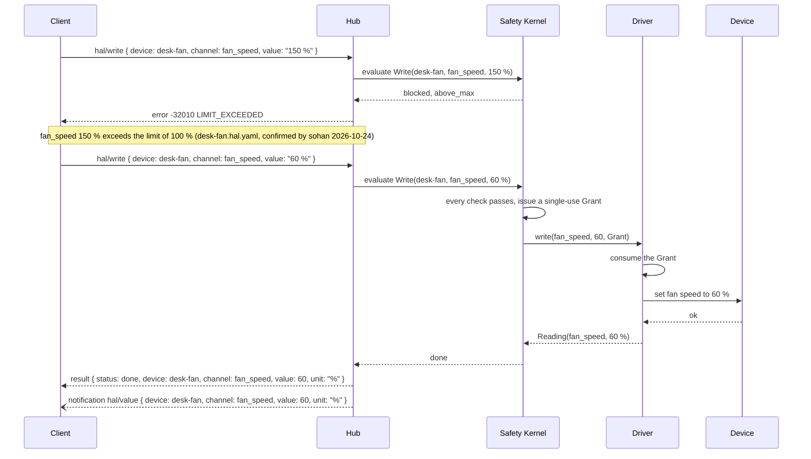

# Architecture

## Roles

| Role | Responsibility |
|---|---|
| Client | Sends requests to a Hub and receives responses and notifications. Holds one token, which the Hub maps to one Principal. |
| Hub | Owns every Device. Loads Device Files, runs Drivers, the Safety Kernel, the confirmation queue, routines and the audit log. Answers Clients over the transports in [Transports](basic/transports.md). |
| Safety Kernel | Evaluates every write and action in a fixed order ([Safety](safety.md)). Issues a Grant only for a command that passes every check. |
| Driver | Speaks one protocol. Reads values and, given a Grant, applies one write, one action or the safe state ([Drivers](drivers.md)). |
| Device | The hardware or bridged system. It is described by its Device File and is never reached except through its Driver. |

## The one-hub model

1. One Hub process MUST own every Device it serves. Only the Hub opens hardware.
2. Every Client is a thin client of the Hub. A Client MUST NOT open a Device directly.
3. Every write and every action, from any source, MUST be evaluated by the Hub's Safety Kernel. Sources include Clients, routines, the Hub's own watchdog and the stop command.
4. A Driver MUST NOT change hardware except by consuming a Grant issued by that Hub's Safety Kernel.
5. Two Hubs MUST NOT open the same Device at the same time. The reference Hub takes an exclusive lock file per device port.

Because one Hub sees every command, rate limits, interlocks across Devices and watchdog budgets hold no matter which Client sent a command.

The reference Hub also serves a REST API under `/v1` for its dashboard and scripts. It calls the same Hub functions as the protocol, so behavior is identical. The REST API is not part of this specification.

## One blocked and one granted write

The Device File for `desk-fan` limits `fan_speed` to 100 %. A human named sohan confirmed that limit on 2026-10-24. The fan runs at 20 %. An agent Client asks for 150 % and then for 60 %.

The blocked write never reaches the Driver. The granted write reaches it exactly once, and the Grant cannot be used again.

## MCP mapping

MCP stays the agent-facing interface. The reference MCP server maps its tools onto protocol methods.

| MCP tool | Method |
|---|---|
| `hub_status` | `hal/initialize` result |
| `list_devices` | `hal/devices/list` |
| `describe_device` | `hal/devices/describe` |
| `read`, `read_many` | `hal/read` |
| `write` | `hal/write` |
| `action` | `hal/action` |
| `dry_run`, `plan_check` | `hal/dryRun` |
| `stop_all` | `hal/stop` |
| `get_confirmation_status` | `hal/confirmations/list` |
| `list_routines` | `hal/routines/list` |
| `run_routine_dry` | `hal/routines/dryRun` |
| `get_audit_log` | `hal/audit/query` |

MCP tool results MUST carry the same error names, codes and messages as the protocol. Routine drafting, discovery and driver writer tools are MCP and REST only in this version.
